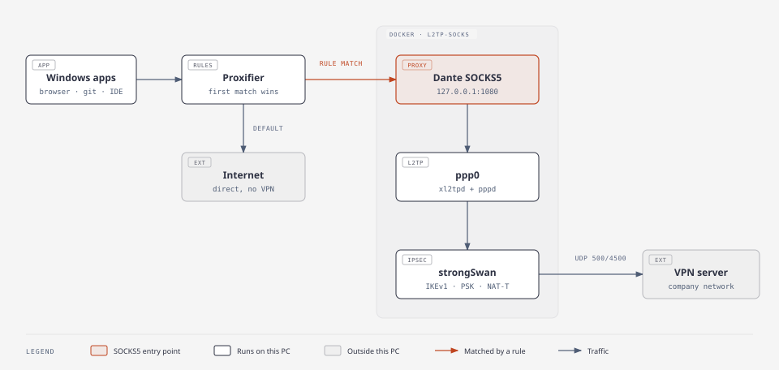

# VPN L2TP/IPsec → proxy SOCKS5 cục bộ (split tunnel kiểu Proxifier)

[English](README.md) | Tiếng Việt

Kết nối VPN L2TP/IPsec của công ty mà **không** phải cho cả máy đi qua VPN.
VPN chạy trong một container Docker nhỏ và Windows chỉ thấy nó dưới dạng một
proxy SOCKS5 tại `127.0.0.1:1080`. Proxifier sẽ quyết định, theo từng app / domain / IP / port,
cái nào đi qua VPN và cái nào đi thẳng.



Vì sao làm vậy:
- Không đụng tới routing, DNS hay card mạng của Windows, nên không có chuyện "VPN chiếm hết traffic".
- Bật/tắt VPN chỉ là start/stop một container.
- Có thể chạy nhiều VPN song song (mỗi VPN một container và một port).

## Các file

| File | Công dụng |
|---|---|
| `Dockerfile` | Image Alpine có strongSwan (IPsec), xl2tpd + pppd (L2TP), Dante (SOCKS5) |
| `entrypoint.sh` | Đọc cấu hình và secret, kết nối, đặt route/DNS, khởi động proxy |
| `docker-compose.yml` | Chạy container, truyền thông tin đăng nhập dưới dạng Docker secret, chỉ publish proxy trên `127.0.0.1:1080` |
| `vpn.cmd` / `vpn.ps1` | Script hỗ trợ: `setup`, `start`, `stop`, `status`, `restart`, `reconnect`, `logs`, `apply` |
| `doh-apply.ps1` / `doh-rollback.ps1` | Tùy chọn: bật / tắt DNS mã hóa cho Windows (Cloudflare DNS over HTTPS), xem [DNS mã hóa](#tùy-chọn-mã-hóa-dns-của-windows-dns-over-https) |
| `.env` | Do `setup` tạo: IP server và DNS (không bắt buộc). **Không chứa secret.** |
| `vpn-secrets.xml` | Do `setup` tạo: username, password, PSK **đã mã hóa** (xem [Thông tin đăng nhập và bảo mật](#thông-tin-đăng-nhập-và-bảo-mật)) |
| `.env.example` | Ví dụ nội dung của `.env` |
| `.github/workflows/gitleaks.yml` | Quét mọi lần push và pull request để tìm secret bị commit nhầm ([gitleaks](https://github.com/gitleaks/gitleaks)) |

`.env` và `vpn-secrets.xml` là file cá nhân và đã có trong `.gitignore`. Đừng chia sẻ chúng.

## Yêu cầu

- Windows 10/11 có **Docker Desktop** (backend WSL2) đang chạy.
  Mẹo: Docker Desktop → Settings → General → *Start Docker Desktop when you sign in*.
  Cần Docker Compose bản mới (đã thử với Compose 5.6.0; kiểm tra bằng `docker compose version`).
- **Proxifier** (Windows).
- Lấy từ DevOps: **IP của VPN server**, **pre-shared key (PSK)**, **username**, **password**.

## Cài đặt nhanh (khuyến nghị)

1. **Chép thư mục** về máy (ví dụ `D:\vpn`) rồi mở PowerShell hoặc CMD tại đó.
2. **Chạy setup** và trả lời các câu hỏi (password và PSK không hiện ra khi gõ):
   ```powershell
   .\vpn.cmd setup
   ```
   Script kiểm tra Docker (tự mở Docker Desktop nếu cần), lưu cấu hình (thông tin đăng nhập
   được mã hóa), build image, kết nối và đợi đến khi VPN lên:
   ```
   VPN server IP: 203.0.113.10
   Username: your.name
   Password: ********
   Pre-shared key (PSK): ********
   Internal DNS servers, comma separated (optional, Enter to skip):
   [OK]   Settings saved (.env) and credentials encrypted (vpn-secrets.xml)
   [..]   Connecting.........
   [..]   ppp0 up: 10.x.x.x/32
   [..]   DNS: 10.x.x.x
   [OK]   VPN connected. Proxy: SOCKS5 127.0.0.1:1080
   ```
   - Sai username/password hoặc PSK → script **tự dừng** (để tài khoản không bị khóa)
     và báo sai ở đâu. Sửa bằng cách chạy lại `.\vpn.cmd setup`
     (nhấn Enter để giữ các giá trị đã đúng).
   - "Cannot reach the VPN server" → kiểm tra IP server / mạng của bạn.
3. **Cấu hình Proxifier** (xem [Cấu hình Proxifier](#cấu-hình-proxifier)).

Xong. VPN chạy nền, tự kết nối lại khi bị rớt, và tự chạy lại mỗi khi Docker Desktop
khởi động.

`vpn.cmd` chạy `vpn.ps1` mà không đổi execution policy của PowerShell. Nếu policy của bạn
đã cho phép chạy script thì `.\vpn.ps1 <command>` cũng chạy y như vậy.

Luôn nhập thông tin đăng nhập qua `setup`. Đừng ghi chúng vào `.env`, cũng đừng gõ chúng
thành lệnh PowerShell (`$env:VPN_PASSWORD=...`): PowerShell lưu các lệnh đã gõ vào một file
history dạng text thường. Script sẽ từ chối chạy nếu thấy thông tin đăng nhập trong `.env`.

## Cấu hình Proxifier

1. **Profile → Proxy Servers → Add**
   - Address `127.0.0.1`, Port `1080`, Protocol **SOCKS Version 5**, không xác thực.
   - Bấm *Check* để thử.
2. **Profile → Name Resolution**
   - Bật **Resolve hostnames through proxy**.
     Nếu không bật, Windows sẽ tự phân giải các tên nội bộ (`*.company.local`) và thất bại.
3. **Profile → Proxification Rules** (xét từ trên xuống, rule nào khớp trước thì dùng rule đó):

   | Thứ tự | Tên | Applications | Target hosts / ports | Action |
   |---|---|---|---|---|
   | 1 | VPN server bypass | Any | `<VPN_SERVER IP>` | **Direct** |
   | 2 | Docker bypass | `com.docker.*.exe; vpnkit.exe; wsl*.exe; Docker Desktop.exe` | Any | **Direct** |
   | 3 | Company | Any | ví dụ `*.company.local; 10.99.*.*` hoặc port `1433` | **Proxy SOCKS5 127.0.0.1** |
   | cuối | Default | Any | Any | **Direct** |

   Rule 1–2 giữ cho tunnel không bị vòng lại qua chính nó nếu sau này bạn thêm một rule rộng.
   Hỏi DevOps các domain / dải IP nội bộ mà bạn cần.
   Ví dụ: target `gitlab.company.local`, port Any → **VPN** (`127.0.0.1:1080`).
4. **Cài đặt trình duyệt** (Chrome / Edge). Thiếu các bước này, trình duyệt có thể đi vòng qua Proxifier:
   - **Tắt QUIC (HTTP/3):** mở `chrome://flags/#enable-quic` (Edge: `edge://flags/#enable-quic`)
     → **Disabled** → khởi động lại trình duyệt. QUIC dùng UDP, mà Proxifier không đẩy UDP qua proxy,
     nên các site đứng sau Cloudflare sẽ đi thẳng.
   - **Tắt Secure DNS:** Settings → Privacy and security → Security → *Use secure DNS* → Off.
     Khi bật, Proxifier không bao giờ thấy hostname, nên các rule theo domain không khớp.
   - Sau khi đổi bất cứ thứ gì, **thoát hẳn trình duyệt** (cả icon dưới khay hệ thống),
     hoặc xóa cache: `chrome://net-internals/#dns` → *Clear host cache*, rồi
     `chrome://net-internals/#sockets` → *Flush socket pools*.

   Về bảo mật: tắt QUIC không mất gì (trình duyệt quay về HTTP/2 qua TLS).
   Tắt Secure DNS thì truy vấn DNS cho các site ngoài VPN sẽ không được mã hóa, nên nhà mạng
   hoặc bên vận hành Wi-Fi công cộng có thể thấy bạn vào những domain nào. Tên miền công ty vẫn
   được phân giải bên trong tunnel. Muốn khắc phục, hãy mã hóa DNS của Windows (xem [DNS mã hóa](#tùy-chọn-mã-hóa-dns-của-windows-dns-over-https)),
   hoặc chỉ dùng các cài đặt này trên một trình duyệt riêng dành cho site công ty.

## Tùy chọn: mã hóa DNS của Windows (DNS over HTTPS)

Khi tắt Secure DNS, trình duyệt nhờ Windows tra tên miền, và mặc định Windows gửi các truy vấn
đó tới router / nhà mạng mà không mã hóa. `doh-apply.ps1` cho Windows gửi chúng tới Cloudflare
(`1.1.1.1`, `1.0.0.1`) ở dạng mã hóa. VPN và các rule Proxifier vẫn hoạt động: Proxifier vẫn
thấy mọi hostname, và tên miền công ty vẫn được phân giải trong tunnel.

Cần Windows 11. Mỗi script sẽ xin quyền admin (hộp thoại UAC).

```powershell
# Turn on (uses the adapter you're online with; or add -Adapter "Wi-Fi")
powershell -ExecutionPolicy Bypass -File .\doh-apply.ps1
# Turn off: puts back the DNS servers you had before
powershell -ExecutionPolicy Bypass -File .\doh-rollback.ps1
```

`doh-apply.ps1`:
1. Lưu cấu hình DNS hiện tại vào `doh-logs\backup.xml` (rollback dùng file này).
2. Đặt DNS của card mạng thành `1.1.1.1`, `1.0.0.1` với DNS over HTTPS và **không fallback về DNS thường**.
3. Tự kiểm chứng: ghi lại traffic DNS (port 53) trong lúc tra một tên ngẫu nhiên, và in
   `PASS` nếu tên đó được phân giải mà không có truy vấn nào rời máy ở dạng chưa mã hóa. Một truy
   vấn đối chứng cố ý gửi bằng DNS thường phải xuất hiện trong bản ghi, nên `PASS` không thể
   đến từ một lần capture bị hỏng.

Sau đó chạy lại [các lệnh test `curl`](#vận-hành-hằng-ngày-runbook); chúng vẫn phải in `HTTP 200`.

Settings → Network → card mạng của bạn vẫn ghi các server là *Unencrypted*. Chuyện này bình
thường: script bật DoH cho toàn hệ thống với các địa chỉ của Cloudflare (`Get-DnsClientDohServerAddress`
hiện `AutoUpgrade True`), còn trang đó chỉ hiện cài đặt riêng của từng card mạng. Kết quả
`PASS` của script mới là bằng chứng truy vấn đã được mã hóa.

Cần biết thêm:
- **VPN client khác** có đổi DNS của Windows (FortiClient, Cisco, …): chạy cả hai script khi
  VPN đó đang **ngắt kết nối**. Các client này lưu danh sách DNS lúc kết nối và trả lại lúc
  ngắt, nên thay đổi làm trong lúc đang kết nối sẽ bị mất. Áp dụng lúc đã ngắt thì thay đổi
  vẫn giữ nguyên qua các lần kết nối và ngắt sau đó (đã thử với FortiClient).
- **Trang đăng nhập Wi-Fi ở khách sạn / quán cà phê** có thể không hiện, vì không có fallback về DNS thường.
  Chạy `doh-rollback.ps1`, đăng nhập, rồi chạy lại `doh-apply.ps1`.
- **Theo từng card mạng**: Wi-Fi và Ethernet tách riêng. Chạy với `-Adapter "<name>"` cho card còn lại.
- **Đánh đổi về riêng tư**: giờ Cloudflare, chứ không phải nhà mạng, sẽ thấy các tên miền bạn tra.
- Log, bản backup và bản ghi traffic nằm trong `doh-logs\`, thư mục này được git bỏ qua.

## Vận hành hằng ngày (runbook)

Chạy các lệnh này trong thư mục project. `start`, `restart`, `reconnect`, `apply` và `setup` sẽ đợi
đến khi VPN kết nối xong rồi báo kết quả (chúng dừng VPN nếu thông tin đăng nhập sai).

| Việc cần làm | Script | Lệnh Docker tương đương |
|---|---|---|
| Cài đặt lần đầu / đổi cấu hình hoặc thông tin đăng nhập | `.\vpn.cmd setup` | chỉ có script |
| Bật VPN | `.\vpn.cmd start` | chỉ có script (script giải mã thông tin đăng nhập) |
| Tắt VPN | `.\vpn.cmd stop` | `docker compose down` |
| Trạng thái (container, IP VPN, proxy) | `.\vpn.cmd status` | `docker compose ps` (phải là `Up`, không phải `Restarting`) |
| Restart nhanh | `.\vpn.cmd restart` | `docker compose restart` (khi container đang chạy) |
| Kết nối lại hoàn toàn (tạo container mới) | `.\vpn.cmd reconnect` | chỉ có script |
| Xem log trực tiếp (Ctrl-C để thoát) | `.\vpn.cmd logs` | `docker compose logs -f` |
| Áp dụng thay đổi trong `.env` / file vừa cập nhật | `.\vpn.cmd apply` | chỉ có script |
| Xem trợ giúp | `.\vpn.cmd` | |
| Xem route trong container | | `docker compose exec vpn ip route` (default phải là `dev ppp0`) |

Khi nào dùng lệnh nào?
- Site nội bộ không vào được → `restart`; vẫn lỗi → `reconnect`; vẫn lỗi → `logs`.
- Đổi password / PSK / username → `setup` (nhấn Enter để giữ các giá trị không đổi).
- Đổi IP server hoặc DNS → `setup`, hoặc sửa `.env` rồi `apply`.
- Vừa kéo về bản mới của các file này → `apply`.

**Kiểm tra proxy từ Windows:**
```powershell
# Straight to the proxy (skips Proxifier rules)
curl.exe -sS -o NUL -w "HTTP %{http_code}`n" --socks5-hostname 127.0.0.1:1080 https://gitlab.company.local/users/sign_in
# Through Proxifier, the same way the browser goes (needs the rule for that host)
curl.exe -sS -o NUL -w "HTTP %{http_code}`n" https://gitlab.company.local/users/sign_in
# Exit IP through the VPN (should differ from your normal public IP)
curl.exe -s --socks5-hostname 127.0.0.1:1080 https://api.ipify.org
```
Cả hai lệnh test trang đều in `HTTP 200` nghĩa là VPN, proxy và Proxifier đều ổn. Nếu trình duyệt
vẫn lỗi, xem dòng về trình duyệt trong phần Xử lý sự cố.

## Xử lý sự cố

| Triệu chứng (dòng log / hiện tượng) | Nguyên nhân thường gặp → cách sửa |
|---|---|
| `initiate failed: CHILD_SA 'l2tp' not established` mà chỉ có các dòng `sending retransmit` | Không tới được server: sai `VPN_SERVER`, hoặc mạng của bạn chặn UDP 500/4500. Thử mạng khác / hỏi DevOps. |
| `AUTHENTICATION_FAILED`, `decryption failed` hoặc `invalid HASH` | Sai **PSK**. Chạy lại `.\vpn.cmd setup`. |
| `NO_PROPOSAL_CHOSEN` | Server dùng bộ mã hóa không có trong danh sách của mình. Gửi log cho người đang bảo trì repo này (các proposal nằm trong `entrypoint.sh`). |
| `ppp0 did not come up (check user/password)` | Sai username/password, hoặc tài khoản bị khóa. Script đã tự dừng VPN giúp bạn; sửa bằng `.\vpn.cmd setup`. |
| Container cứ ở trạng thái `Restarting` | Chạy `.\vpn.cmd logs` rồi đối chiếu với các dòng ở trên. |
| Proxy chạy với IP nhưng không chạy với hostname | Bật *Resolve hostnames through proxy* trong Proxifier; nếu vẫn lỗi, đặt `VPN_DNS` trong `.env`. |
| `cannot complete SOCKS5 connection ... (5)` / container phân giải tên ra `127.112.x.x` | Container đã dùng DNS của Windows, và Proxifier trả lời bằng IP giả. Đã sửa trong `entrypoint.sh`: nếu VPN không gửi DNS, container dùng 1.1.1.1 / 8.8.8.8 qua tunnel. Chạy `.\vpn.cmd apply` sau khi cập nhật. |
| Các lệnh test `curl` trả về `HTTP 200` nhưng trình duyệt không mở được site | Lỗi phía trình duyệt: tắt QUIC, tắt Secure DNS, rồi thoát hẳn trình duyệt hoặc xóa cache (xem bước 4 ở [Cấu hình Proxifier](#cấu-hình-proxifier)). Thử cửa sổ ẩn danh. Cửa sổ Proxifier phải cho thấy các kết nối tới site đó đi qua **VPN**. |
| Tên chỉ có trong mạng nội bộ (ví dụ `*.company.local`) không phân giải được | VPN không gửi DNS server nào nên container dùng DNS công cộng. Hỏi DevOps IP của DNS nội bộ, đưa vào `VPN_DNS` (qua `.\vpn.cmd setup`), rồi chạy `.\vpn.cmd apply`. |
| Request nhỏ thì được, còn HTTPS/tải dữ liệu lớn thì bị treo | Lỗi MTU. Trong `entrypoint.sh` đổi `mtu 1280` / `mru 1280` thành `1200`, rồi chạy `.\vpn.cmd apply`. |
| `port is already allocated` / port 1080 đang bị dùng | Đổi port trong `docker-compose.yml` thành `"127.0.0.1:1081:1080"` và dùng 1081 trong Proxifier. |
| IP nội bộ nằm trong dải `172.16.0.0`–`172.31.255.255` và không vào được | Trùng với mạng của Docker. Thêm một subnet riêng vào `docker-compose.yml` (ví dụ `192.168.250.0/24`). |
| Khởi động lại máy xong thì không gì chạy | Docker Desktop chưa chạy. Chạy `.\vpn.cmd start` (script tự mở Docker Desktop). |
| `docker: command not found` / lỗi engine | Mở Docker Desktop và đợi đến khi hiện *Engine running*. |
| `Cannot decrypt vpn-secrets.xml` | File được tạo trên máy khác hoặc bởi một user Windows khác (theo thiết kế, file chỉ dùng được với đúng tài khoản đã tạo ra nó). Chạy `.\vpn.cmd setup`. |
| `No saved credentials` | Chạy `.\vpn.cmd setup`. |
| `VPN_PASSWORD found in .env in plain text` (hoặc USER / PSK) | Xóa dòng đó khỏi `.env`, rồi chạy `.\vpn.cmd setup`. |
| `Secret vpn_psk is missing or empty` | Chạy `.\vpn.cmd setup`. |
| `environment variable "VPN_USER" required by secret ... is not set` | Bạn đã chạy thẳng `docker compose up`. Hãy dùng `.\vpn.cmd start`. |
| Không tên miền nào phân giải được sau khi chạy `doh-apply.ps1` (hoặc trang đăng nhập Wi-Fi không mở) | Cloudflare bị chặn hoặc mạng bắt đăng nhập trước. Chạy `doh-rollback.ps1`. |

Log không bao giờ in password hay PSK của bạn, nên bạn có thể gửi log cho team.

## Chạy VPN thứ hai song song

Copy thư mục, rồi trong bản copy:
1. Trong `docker-compose.yml` đổi `container_name` (ví dụ `l2tp-socks-2`) và port (`"127.0.0.1:1081:1080"`).
2. Xóa `.env` / `vpn-secrets.xml` nếu bị copy theo, rồi chạy `.\vpn.cmd setup` trong thư mục đó.
3. Trong Proxifier, thêm proxy `127.0.0.1:1081` và các rule trỏ tới nó.

## Thông tin đăng nhập và bảo mật

Username, password và PSK được xử lý như sau:

| Ở đâu | Dạng lưu |
|---|---|
| `vpn-secrets.xml` | Mã hóa bằng **Windows DPAPI**. Chỉ **tài khoản Windows của bạn trên máy này** giải mã được. Copy sang máy khác hoặc để user khác mở thì file vô dụng. |
| `.env` | Chỉ có IP server và DNS. Không có secret. |
| Phiên PowerShell / CMD | Chỉ được giải mã trong vài giây lúc `docker compose up` chạy, sau đó bị xóa (kể cả khi có lỗi). |
| Container Docker | Truyền vào dưới dạng Docker secret (file trong `/run/secrets`). Không hiện trong `docker inspect` hay biến môi trường của container. |
| Log | Không bao giờ được in ra. Có thể chia sẻ log an toàn. |

Cách làm này bảo vệ bạn trước: các user Windows khác trên máy, người lấy được bản copy của
thư mục (ổ mạng dùng chung, file zip, USB), và việc vô tình commit lên git.

Những gì nó **không** bảo vệ được:
- **Admin của máy** hoặc **malware chạy dưới tài khoản của bạn**. Bất cứ thứ gì chạy dưới tài khoản
  của bạn đều giải mã được dữ liệu DPAPI, giống như cách Windows giải mã password đã lưu trong trình duyệt.
- **Quyền truy cập Docker khi container còn tồn tại.** Container giữ một bản copy của secret để
  tự kết nối lại. Ai chạy được lệnh `docker` trên máy này (thường chỉ có bạn và admin) đều có thể
  đọc chúng bằng `docker exec`. `.\vpn.cmd stop` xóa container cùng bản copy đó.

Ngoài ra:
- Proxy **không có password**, nên chỉ listen trên `127.0.0.1`. Đừng đổi thành `0.0.0.0`:
  làm vậy sẽ mở mạng công ty cho cả mạng LAN của bạn.
- Để xóa toàn bộ thông tin đăng nhập đã lưu: chạy `.\vpn.cmd stop`, rồi xóa `vpn-secrets.xml`.

## Giới hạn

- Qua SOCKS **chỉ có TCP**. `ping`, phần lớn UDP và các app không dùng proxy sẽ không đi qua VPN.
- Chỉ dùng được với VPN L2TP/IPsec xác thực bằng pre-shared key + username/password.
  Hãy hỏi DevOps/IT xem chính sách công ty có cho dùng client không chính thức hay không.
